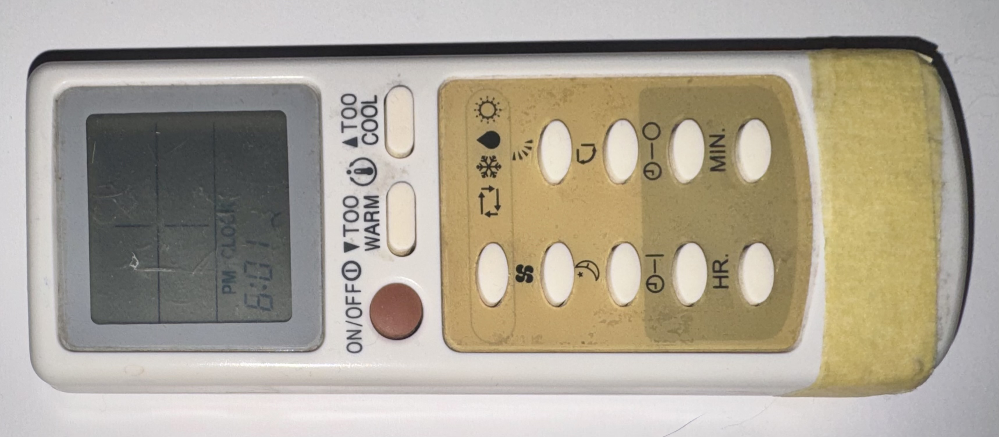

# EG9 Climate - Custom Component for ESPHome

Custom ESPHome climate component for controlling air conditioners using the proprietary **EG9 IR protocol** (14-byte / 112-bit frame).

> [!NOTE]
> **Disclaimer:** Almost all the code, reverse engineering scripts, and documentation in this repository were generated by an AI assistant. It's essentially 100% pure AI slop that somehow actually compiles and works! Use at your own risk.

---

## The Remote Control

I am not entirely sure what the exact model name/number of this remote control is, but it looks like this:



*(At least, Google said that it's called EG9)*

---

## Overview

The EG9 protocol features a non-linear checksum algorithm that cannot be computed using standard arithmetic sums or CRCs. To solve this, this component implements a **hybrid architecture**:
1. **Dynamic payload construction:** Power, operating mode, temperature, fan speed, and vane swing position are encoded dynamically on the fly into the settings payload (`B6`–`B12`).
2. **Pre-compiled checksum dictionary:** The 13th byte (sequence/dynamic byte) and 14th byte (checksum) are retrieved from an embedded lookup table (`std::map`), compiled from exhaustive IR captures.

### Supported Features
- **Modes:** `Cool`, `Heat`, `Off`
- **Temperature Range:** 16°C – 31°C (1.0°C step)
- **Fan Speeds:** `Auto`, `Quiet`, `Low`, `Medium`, `High`
- **Vane Positions / Presets:** `Auto`, `Top`, `Medium-Top`, `Medium`, `Medium-Bottom`, `Bottom`, `Swing` (vertical continuous oscillation)

---

## How It Works

Each IR transmission consists of a 14-byte frame modulated at **38 kHz**:
```text
[Header: 5B] [B6: Power] [B7: Mode] [B8: Temp] [B9: Fan & Vane] [B10-B12: 0x00] [B13: Dynamic] [B14: CRC]
```

- **Header (`B1`–`B5`):** Static prefix `0xC4, 0xD3, 0x64, 0x80, 0x00`
- **Power (`B6`):** `0x24` (ON) / `0x04` (OFF)
- **Mode (`B7`):** `0xC0` (Cool) / `0x80` (Heat)
- **Temperature (`B8`):** `(reverse_bits(31 - Temp)) << 4`
- **Fan & Vane (`B9`):** `(FanCode << 5) | VaneCode`
- **CRC Lookup:** Matches the 7-byte settings key against `IR_CODE_DICTIONARY` to retrieve `{B13, B14}`.

For a detailed protocol breakdown, see [docs/PROJECT_SUMMARY.md](docs/PROJECT_SUMMARY.md).

---

## Dataset & Maintenance

The component is backed by an exhaustive dataset covering **all 1,120 operational combinations** (16 temperatures × 5 fan speeds × 7 vane positions for both Cool and Heat modes) plus power-off states:
- **Master dataset:** [`tools/dumps/ir_dictionary.csv`](tools/dumps/ir_dictionary.csv) (1,127 deduplicated unique records).
- **Data collection:** Raw timing samples were recorded via Flipper Zero (Flipper CLI in browser), decoded using `tools/decode_ir.py`, and compiled into C++ using `tools/generate_ir_dictionary.py`.
- **Samples:** Minimal raw timing input and decoded output samples are provided in [`tools/dumps/samples/`](tools/dumps/samples/).

To verify dataset coverage:
```bash
python3 tools/verify_coverage.py tools/dumps/ir_dictionary.csv
```

---

## How to Use in Your ESPHome Project

1. Add the component via `external_components`:

```yaml
external_components:
  - source: github://zojl/esphome-eg9-climate-remote
    components: [ eg9_climate ]
```

2. Configure your IR transmitter:

```yaml
remote_transmitter:
  - pin: GPIO2
    carrier_duty_percent: 50
    id: remote_transmitter_1
```

3. Configure the climate entity:

```yaml
climate:
  - platform: eg9_climate
    name: "Living Room AC"
    transmitter: remote_transmitter_1
    # Optional: creates a dedicated select entity instead of presets inside climate card
    # vane_select_name: "Living Room AC Vane Position"
```

### 3. Home Assistant Integration

Once flashed, Home Assistant will automatically discover the climate entity with full thermostat controls:
- **Mode buttons:** Cool, Heat, Off
- **Target temperature slider:** 16°C – 31°C
- **Fan modes:** Auto, Quiet, Low, Medium, High
- **Swing:** Vertical continuous oscillation (`swing_mode: VERTICAL` vs `OFF`)
- **Vane Position Presets:** Fixed positions (`Auto`, `Top`, `Medium-Top`, `Medium`, `Medium-Bottom`, `Bottom`) are available right inside the climate card as presets. If `vane_select_name` is configured, they move into a separate select entity instead.

